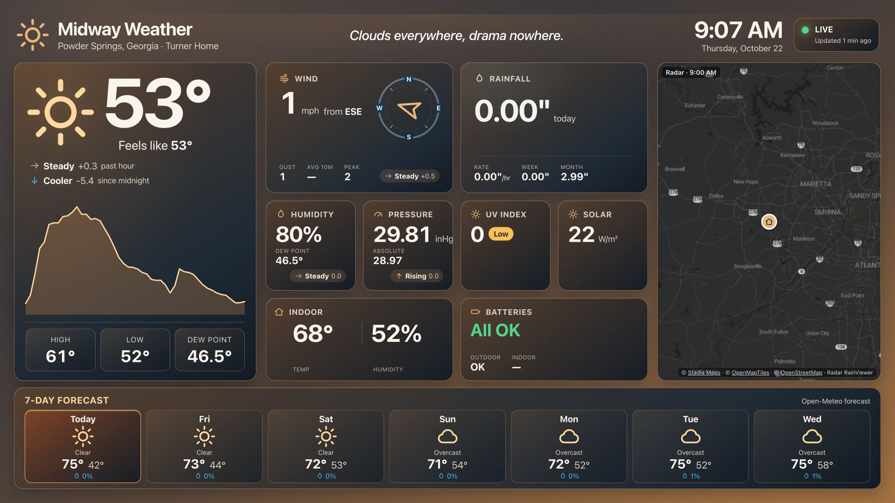
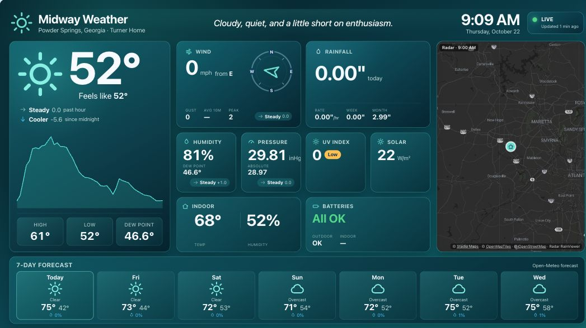
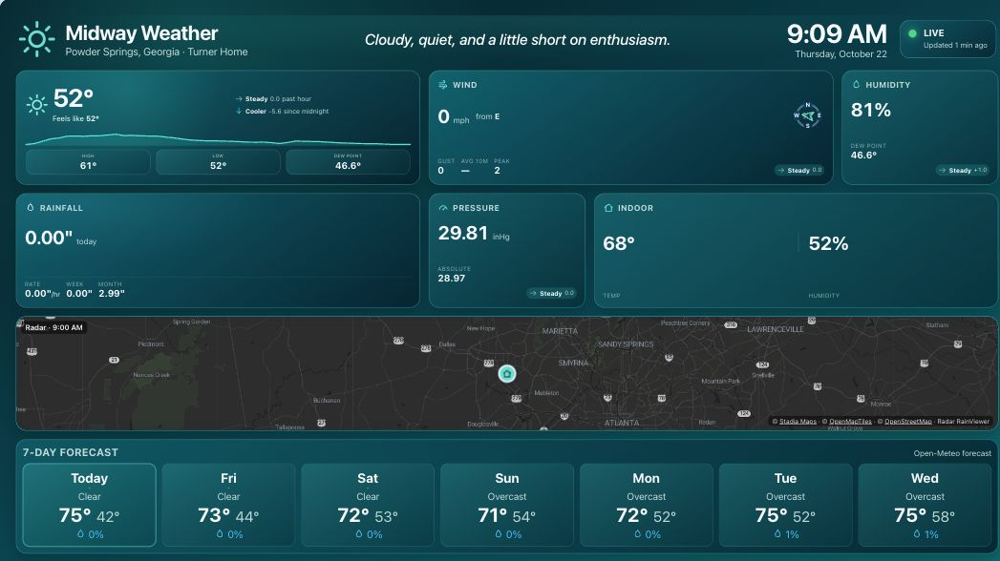
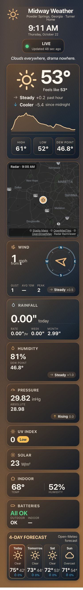
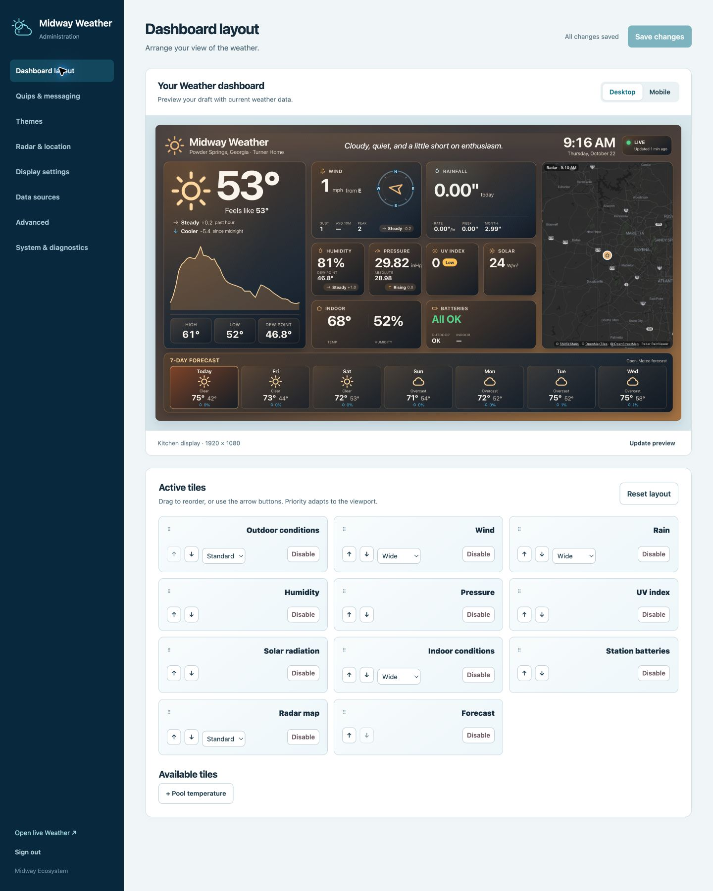
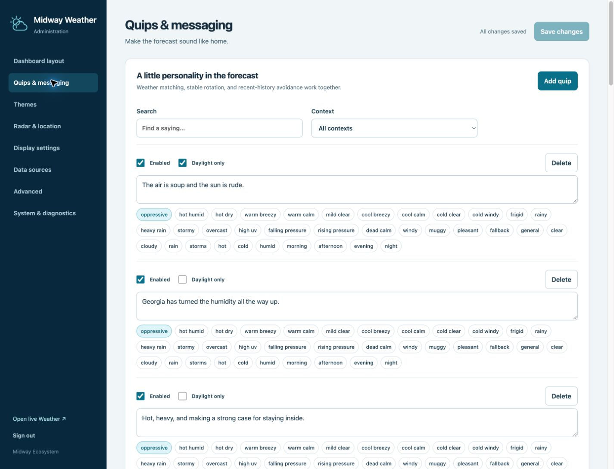
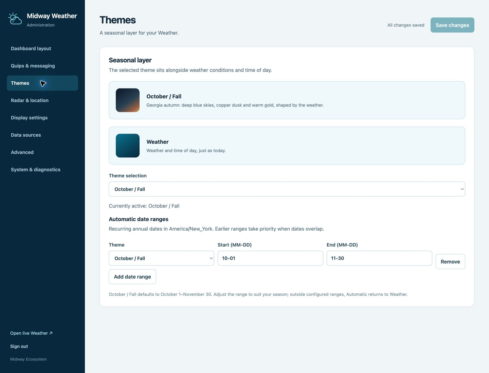
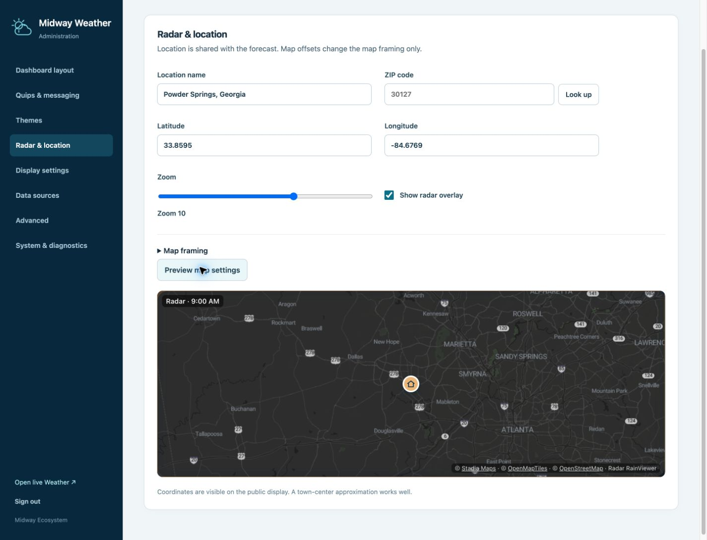
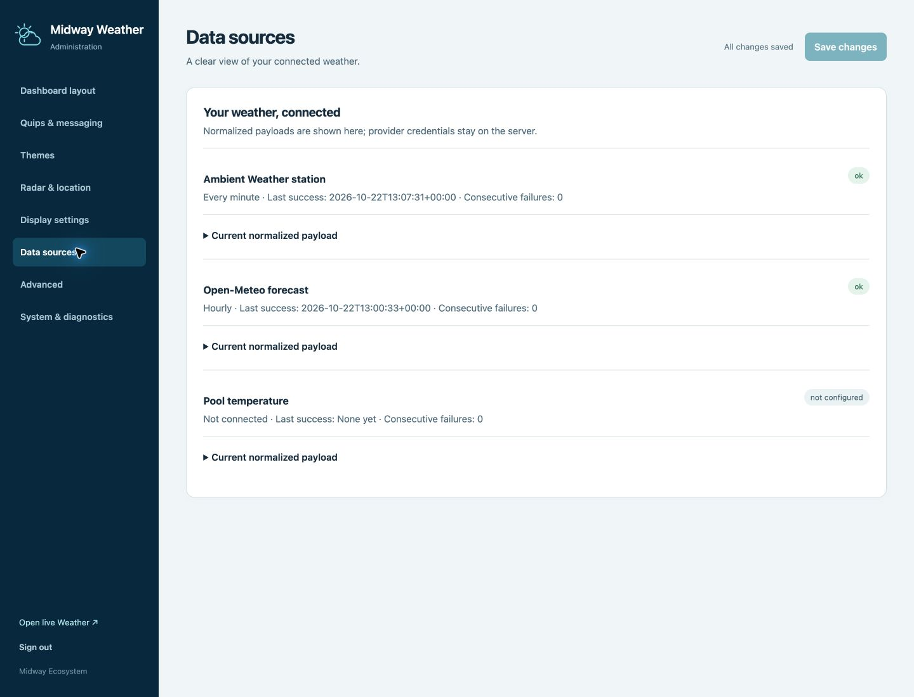
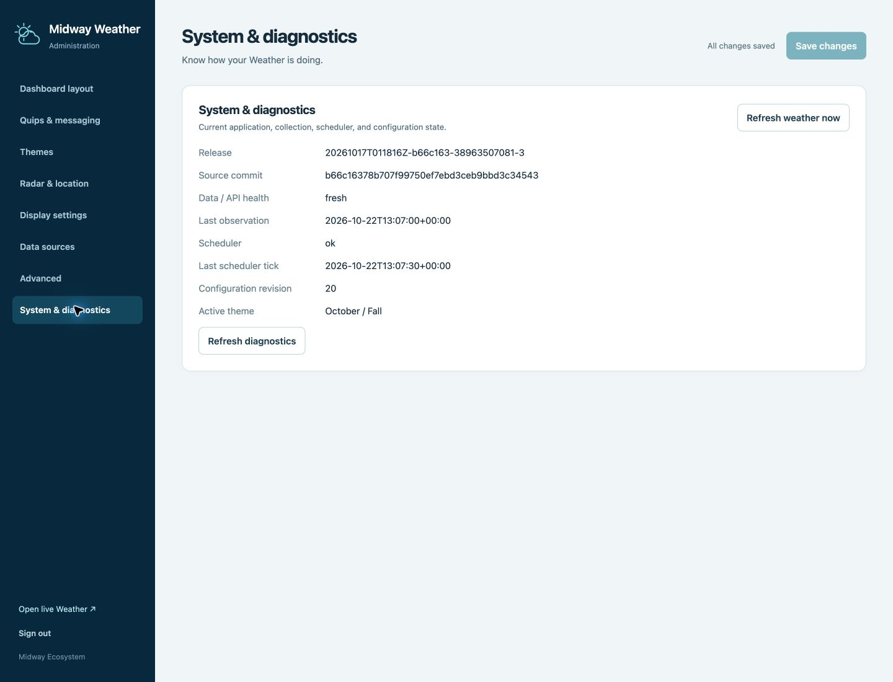

# Screenshot tour

Captured October 22, 2026 from the production application at [weather.midway-ecosystem.com](https://weather.midway-ecosystem.com/). These are real observations and interfaces, not mockups. Readings, freshness, and release identifiers describe the capture time.

The primary dashboard uses a 1920×1080 viewport. Mobile uses a 390×844 browser viewport with a full-page capture. Admin uses a 1440×1800 viewport for the complete layout editor and 1440×1100 for other sections. Standard-theme and alternate-layout images crop the real dashboard draft iframe, which renders a 1920×1080 desktop layout scaled by the supported admin preview. Browser image dimensions can differ slightly due to scrollbars and device scaling.

Alternate views were produced through the authenticated theme selector, tile reordering, tile-disable controls, and Update preview. **No settings were saved.** Reloading discarded drafts; diagnostics retained configuration revision 20 and the October / Fall theme. Public coordinates are the configured town-center approximation. Captures omit browser chrome, credentials, raw provider payloads, and expanded diagnostic payloads.

## The household display

The primary layout combines current conditions and temperature history, station metrics, the latest radar map, and seven forecast days. Clear weather in this capture means the radar has no precipitation to highlight.

## Themes and alternate layouts

The standard Weather palette with the original tile selection, rendered from current observations in an unsaved preview.

Humidity moves ahead of rainfall; UV, solar, and battery tiles are disabled in this draft. The grid reflows, including a wider radar row. This view is a configuration example, not the saved production layout.

## On a phone

## Layout and preview

## Quips and messaging

## Themes and recurring date ranges

## Radar and location

## Data sources and connection health

## System diagnostics

